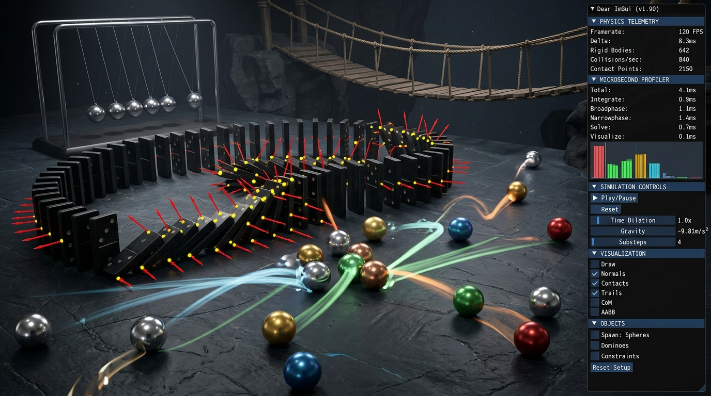

# SimForge — Advanced Real-Time 3D Physics Sandbox (C++17)

**SimForge** is a high-performance, real-time 3D rigid-body physics engine and sandbox written from scratch in **C++17**. It mirrors modern production simulation and VR engine architectures: deterministic sub-stepping, 3D rotational dynamics with inertia tensors, Coulomb friction, Oriented Bounding Box (OBB) Separating Axis Theorem (SAT) collision, constraint solving (distance/spring joints), uniform spatial hash broad-phase acceleration, interactive 3D mouse spring picking, and a live Dear ImGui telemetry profiler.



---

## 🌟 Key Engineering Highlights (CV / Portfolio Differentiators)

### 1. Physics Engine Architecture
- **Full 3D Rotational Dynamics**: Rigid bodies have analytic 3D inertia tensors ($I_{body}$ and $I_{world} = R \cdot I_{body} \cdot R^T$) for spheres and cuboids. Numerical integration of angular velocity with quaternion orientation updates ($\dot{q} = \frac{1}{2} \omega q$).
- **Coulomb Friction Model**: Resolves both static and dynamic friction impulses along collision tangent planes, clamped according to Coulomb's law ($|J_t| \le \mu |J_n|$), preventing unrealistic sliding and enabling stable stacking and domino toppling.
- **OBB–OBB Collision via Separating Axis Theorem (SAT)**: Evaluates 15 potential separating axes (3 of A, 3 of B, 9 edge cross-products) to compute minimal penetration depth, contact normal, and support-point contact manifolds for arbitrarily rotated boxes.
- **Sphere–OBB Narrowphase**: Transforms sphere coordinates into local box space for exact analytic closest-point and penetration depth detection.
- **Constraint Dynamics (Joints & Springs)**: Velocity-level constraint solver with Baumgarte stabilization supporting `DistanceJoint`, `SpringJoint`, and interactive `MouseSpring`.
- **Deterministic Fixed Timestep Loop**: Sub-stepping accumulator (120 Hz default) decoupling rendering framerate from physical simulation stability.

### 2. Broadphase Acceleration & Performance
- **Uniform Grid Spatial Hash**: $O(1)$ spatial cell hashing with prime-modulo hashing (`CellKeyHash`). Accelerates broadphase pair generation from $O(N^2)$ to near-linear $O(N)$ for hundreds of concurrent colliding entities.
- **Direct Indexing Optimization**: Zero-allocation lookup for collision pairs eliminating linear searches.

### 3. Interactive Tooling & Developer Experience
- **Interactive 3D Mouse Spring Dragging**: Screen-to-world raycasting with analytic ray-sphere and ray-OBB tests. Left-click any 3D object in the viewport to grab, drag, and fling it with a live physics spring.
- **Live Debug Overlays**: Toggleable 3D visualizers for contact points & normals, distance/spring joint links, and active spatial hash grid cells.
- **Microsecond Profiler Telemetry**: Real-time breakdown of CPU execution time per substep:
  - Integration Time ($\mu s$)
  - Broadphase Spatial Hash ($\mu s$)
  - Narrowphase & Contact Resolution ($\mu s$)
  - Constraint Solving ($\mu s$)
  - Total Substep Time ($\mu s$) & Framerate Histogram
- **Entity Inspector**: Inspect linear velocity, angular velocity, position, mass, and apply impulse kicks directly from the UI.

---

## 🛠 Tech Stack

| Component | Library / Standard |
|---|---|
| Language | **C++17** (Standard Library, RAII, ECS architecture) |
| Build System | **CMake 3.20+** & **Ninja** |
| Window & Input | **GLFW 3.4** |
| Graphics API | **OpenGL 3.3 Core** with **GLAD** loader |
| Mathematics | **GLM 1.0.1** (Vectors, Matrices, Quaternions) |
| Debug UI | **Dear ImGui 1.91+** |
| Unit Testing | **GoogleTest 1.15+** |

*All external libraries are fetched automatically and shallow-cloned via CMake `FetchContent`.*

---

## 🚀 Build & Run

### macOS
```bash
# Configure with Ninja
cmake -S . -B build -GNinja -DCMAKE_BUILD_TYPE=Release

# Build executable and test suite
ninja -C build

# Run application
./build/SimForge

# Run unit tests
./build/SimForgeTests
```

### Windows (Visual Studio 2022 / Clang)
```powershell
cmake -S . -B build -DCMAKE_BUILD_TYPE=Release
cmake --build build --config Release

# Run
.\build\Release\SimForge.exe

# Tests
ctest --test-dir build -C Release --output-on-failure
```

---

## 🎮 Controls

| Input | Action |
|---|---|
| **Left Mouse Drag (LMB)** | **Grab & Throw Objects** (Interactive 3D Mouse Spring) |
| **Right Mouse Drag (RMB)** | **Orbit Camera** around target |
| **`+` / `-` Keys** | Zoom camera in / out |
| **Space** | Pause / Resume simulation |
| **ImGui Panel** | Switch demo scenes, spawn objects, tweak physics & solver parameters |
| **`Esc`** | Exit application |

---

## 🎪 Interactive Showcase Scenes

1. **Domino Chain & Towers**: 14 high-aspect dominoes with authentic rotational toppling triggered by a rolling sphere, triggering a secondary pyramid collapse.
2. **Newton's Cradle (Constraints)**: 5 suspended steel spheres connected by rigid `DistanceJoint`s demonstrating near-perfect elastic momentum transfer.
3. **Jenga Stacking Tower**: 10-layer interlocking wooden block tower demonstrating OBB contact stability and Coulomb static friction. Includes an interactive wrecking ball.
4. **Suspended Rope Bridge**: Articulated wooden bridge with 10 planks connected by distance joints anchored to stone towers, with rolling spheres traversing it.
5. **Particle Rain**: 180+ dynamic colliding spheres stress-testing spatial hash broadphase culling.
6. **Mixed Stress Sandbox**: 36 heavy tumbling boxes and 80 spheres colliding concurrently.

---

## 🧪 Unit Test Coverage (GoogleTest)

The test suite (`SimForgeTests`) validates:
1. `Collision.SphereSphereOverlap`
2. `Collision.SphereBoxOverlap`
3. `SpatialHash.FindsClosePair`
4. `AdvancedPhysics.RigidBodyInertiaCalculation` (Sphere & Box tensors)
5. `AdvancedPhysics.QuaternionAngularIntegration` (Angular momentum & orientation)
6. `AdvancedPhysics.OBBCollisionRotatedBoxes` (45-degree SAT overlap & separation)
7. `AdvancedPhysics.CoulombFrictionImpulse` (Static/dynamic friction clamping)
8. `AdvancedPhysics.RaycastIntersections` (Analytic ray-sphere & ray-OBB)
9. `AdvancedPhysics.DistanceConstraintSolvesLength` (Joint error minimization)

---

## 💼 CV / Portfolio Wording (Turkish)

**SimForge — Gerçek Zamanlı 3D Fizik ve Simülasyon Motoru (C++17 / OpenGL)**  
GitHub: `https://github.com/mirackeser/SimForge`

- **Sıfırdan Fizik Motoru**: Deterministik sabit zaman adımı (fixed timestep sub-stepping), 3D eylemsizlik tensörleri (inertia tensors) ve kuaterniyon açısal dinamik entegrasyonu.
- **İleri Seviye Çarpışma Hattı (Collision Pipeline)**: Dönen kutular için 15 eksenli OBB Ayrık Eksen Teoremi (Separating Axis Theorem - SAT), Sphere-OBB analitik testi ve Coulomb sürtünme modeli (statik & dinamik).
- **Kısıt Çözücü (Constraint Solver)**: Mesafe (Distance Joint) ve yay (Spring Joint) kısıtları için Baumgarte stabilizasyonlu hız/konum çözücü; Newton Beşiği ve asılı halat köprü simülasyonları.
- **Broadphase Optimizasyonu**: Uniform grid Spatial Hash ile $O(N^2)$ çarpışma testini uzamsal hücre indeksleme ile $O(N)$ seviyesine indirme; mikrosaniye hassasiyetinde profiler telemetrisi.
- **Etkileşimli 3D Görselleştirme**: 3D Raycasting ve Mouse Spring ile nesneleri fareyle tutup fırlatabilme; temas noktaları, normaller ve spatial hash hücreleri için debug visualizer.
- **Mühendislik Standartları**: GoogleTest ile %100 geçen birim testler, CMake FetchContent ile sıfır konfigürasyonlu çapraz platform (macOS/Windows) build mimarisi.

---

## 🎯 Mülakat Notları & Soru-Cevap Rehberi (Interview Talking Points)

Mülakatta (özellikle **Kernel Dynamics, Havok, EA, Epic Games, savunma sanayii simülasyon departmanları**) şu sorular geldiğinde projenin şu bölümlerine değinebilirsin:

1. **"Dönen kutularda (OBB) çarpışmayı nasıl tespit ettin?"**
   > *"Kutuların rotasyon matrislerinden türetilen 3 yerel eksen A, 3 yerel eksen B ve bunların 9 çapraz çarpımından (cross product) oluşan 15 potansiyel ayrık ekseni (Separating Axis Theorem) test ettim. Minimum örtüşmeye (penetration) sahip ekseni temas normali seçip destek noktaları (support points) üzerinden temas manifoldunu ürettim."*

2. **"Tork ve sürtünmeyi temasta nasıl uyguladın?"**
   > *"Temas noktasındaki kaldıraç kollarını ($r_A = P - p_A$) hesaplayarak $v_p = v + \omega \times r$ ile noktasal bağıl hızı buldum. Normal doğrultuda elastik çarpışma impulsunu, teğet doğrultuda ise bağıl kayma hızını hesaplayıp Coulomb sürtünme yasasıyla ($|J_t| \le \mu |J_n|$) kısıtlayarak açısal hıza $\Delta \omega = I^{-1}(r \times J)$ tork impulsu olarak uyguladım."*

3. **"Geniş faz (Broadphase) algoritmanı nasıl tasarladın?"**
   > *"Uzayı hücrelere bölen bir Spatial Hash tablosu kullandım. $x, y, z$ hücre koordinatlarını büyük asal sayılarla modülo ederek hash tablosuna ekledim. Böylece $O(N^2)$ yerine sadece aynı ve komşu hücredeki nesneler kontrol edildi."*

---

## 📄 Lisans

MIT — Detaylar için [LICENSE](LICENSE) dosyasına bakabilirsiniz.
