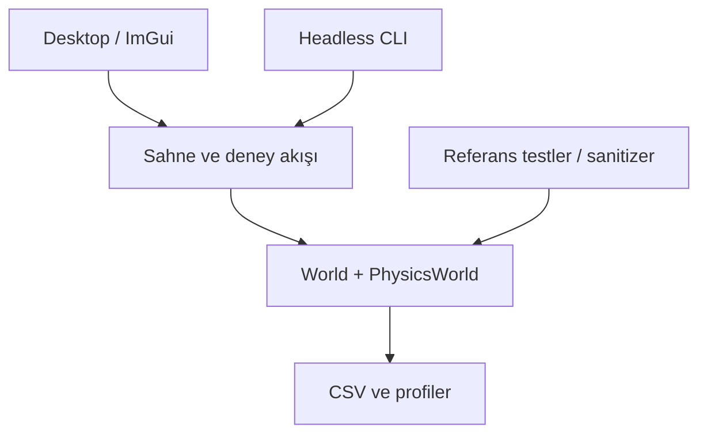

# SimForge mimarisi

## Altı sorumluluk katmanı

| Katman | Bugünkü bileşen | Sorumluluk ve sonraki adım |
|---|---|---|
| 1. Sunum ve giriş | `Application`, `Renderer`, ImGui | Kullanıcı girdisi, 3D görüntü, inspector. Fizik adımını görüntü hızına göre değiştirmez. |
| 2. Uygulama/deney akışı | `DemoScenes`, `SimForgeHeadless` | Sahne seçme, reset, sabit tick çalıştırma, CSV. M2'de deney manifesti ve kayıt/yükleme eklenir. |
| 3. Dünya ve durum | `World`, entity/component tipleri | Transform, kütle, collider, renk, etiket; renderer veya ağ bağımlılığı yok. Kalıcı handle sözleşmesi M2/M3 borcudur. |
| 4. Fizik çekirdeği | `PhysicsWorld`, collision, spatial hash, constraints | Sabit zaman, entegrasyon, aday çiftler, dar faz, impuls ve joint çözümleri. Tek doğruluk kaynağıdır. |
| 5. Veri ve ölçüm | CSV runner + `PhysicsProfileStats` | Fizik izleri ve substep süreleri. Manifest/şema/benchmark deposu planlandı. |
| 6. Doğrulama ve derleme sınırı | CTest, sanitizer, render capture | Analitik referans deneyleri, kaynak sınırları, sabitlenmiş bağımlılıklar, platform derlemesi ve gerçek shader çalıştırması. |

## CMake hedefleri

- `SimForgePhysics`: ECS ve tüm fizik kaynakları; yalnızca GLM'e bağlı.
- `SimForgeScenes`: örnek sahneler; `SimForgePhysics` kullanır.
- `SimForgeHeadless`: pencere açmadan aynı sahneleri çalıştırır; CSV fizik izi üretir ve NaN/Inf durumda başarısız çıkar.
- `SimForgeDesktop`: Application, Renderer ve shader kaynakları; ana uygulama ve capture aracı tarafından paylaşılır.
- `SimForgePreview`: aynı sahneyi ve arayüzü gizli pencerede çizerek PPM üretir.
- `SimForge`: GLFW + GLAD + ImGui masaüstü uygulaması; aynı fizik kütüphanesine bağlanır.
- `SimForgeTests`: bu kütüphaneleri doğrudan test eder; fizik kaynaklarının ayrı bir kopyasını derlemez.

`SIMFORGE_BUILD_SANDBOX=OFF` ile GLFW, GLAD, ImGui ve OpenGL keşfi tamamen atlanır. Testler için GLM ve GoogleTest; runner için GLM gerekir. Bağımlılıklar değişmez commit SHA'larıyla FetchContent üzerinden alınır; ilk configure ağ erişimi gerektirir.

## Fizik tick sözleşmesi

`step(world, frameDt)` render zamanını double accumulator'a ekler, en fazla sekiz sabit tick çalıştırır. Aşırı yükte fazladan tam tickler atılır, kesir korunur. Bu gerçek zamanlı etkileşimde kontrollü yavaşlama politikasıdır. Çevrimdışı deneyler zaman kaybetmemek için `stepFixed(world)` kullanır. Bu çağrı tam bir tick çalıştırır ve render accumulator'ına dokunmaz.

Bir tick sırası:

1. Yay ve mouse spring kuvvetleri bir kez uygulanır; hız ve transform entegrasyonu yapılır.
2. Broadphase ve dar faz tick başına bir kez çalışır. OBB yüzleri referans yüzün yan düzlemleriyle kırpılarak en çok sekiz temas noktası üretilir; kenar çiftlerinde segmentlerin en yakın noktaları kullanılır. Velocity iterasyonlarında mesafe jointleri ve normal/iki teğet yönündeki birikimli impulslar çözülür. Restitution hedefi başlangıç hızıyla bir kez hesaplanır; 1 m/s altındaki yaklaşmalarda zıplama bastırılır. Tickler arasında manifold/impuls cache henüz yoktur.
3. Temas penetrasyonu hızlara enerji eklemeden konum düzeltmesiyle azaltılır; position iterasyonlarında mesafe joint hatası düzeltilir.
4. Simülasyon saati sabit dt kadar ilerler. Profiler değerleri son tick'in tüm iterasyon toplamlarıdır; constraint zamanı broadphase/dar fazı içermez.

Tüm temas normalleri A'dan B'ye yönelir; konum düzeltmesi A'yı `-normal`, B'yi `+normal` yönünde taşır. İç içe şekillerde bu ifade çözüm yönü sözleşmesidir. Statik cisimlerin etkin inverse mass'ı sıfırdır. `enableFriction` teğetsel impulsu kapatır. `enableRotationalDynamics=false` açısal entegrasyonu/impulsu durdurur; mevcut spin korunur ve tekrar açılınca devam eder.

`ConstraintSolver::applySpringForces` her tick'te bir kez, `solveVelocityConstraints` ise yalnızca mesafe kısıtları için iteratif çağrılır. Eski birleşik solver imzası bu iki sorumluluğa ayrılmıştır.

## Reset ve tekrarlanabilirlik

`loadDemoScene` dünyayı temizler ve `PhysicsWorld::reset()` çağırır: zaman, accumulator, joints, mouse spring, temaslar, grid ve profiler temizlenir. Solver ayarları korunur. Entity kimlikleri clear sonrasında yeniden kullanılmaz; eski handle yeni cismi işaret edemez. Sahneye ait UI seçimi/drag durumu Application tarafından temizlenir.

Kutular grid'e döndürülmüş dünya AABB'leriyle eklenir; geniş zeminin küresel radius'u kadar gereksiz hacim doldurulmaz. Küreler radius tabanlı sınır kullanır. Aday çiftlerdeki bounding sphere filtresi korunur.

Broadphase çiftleri kanonik `(a < b)` sırada leksikografik olarak sıralanır. Böylece unordered map gezinme ve ekleme sırası solver sırasını belirlemez. Bu, farklı CPU/derleyiciler arasında aynı floating point bitlerini garanti etmez. Rastgele Partikül Yağmuru sahnesi sabit seed kullanır; masaüstü elle spawn işlemleri hâlâ rastgeledir.

CSV sütunları `step,time,entity,x,y,z,vx,vy,vz,qw,qx,qy,qz,wx,wy,wz` şeklindedir. Tüm aktif cisimler her tick sonunda yazılır. CSV henüz sahne ayarlarını/şekilleri içeren bir replay formatı değildir.

## Görsel katman ve kaynak sahipliği

Surface ve shadow shader'ları derleme zamanında gömülüdür. Çalışma dizinine bağımlı asset dosyası yüklenmez. GGX doğrudan aydınlatma, analitik ortam parlamaları, ACES ton eşleme/gamma ve prosedürel malzemeler kullanılır; bu bir HDR çevre haritası veya tam global illumination sistemi değildir. Yönlü ışığın depth framebuffer'ı 2048²'dir, gölgeler 3×3 PCF örneklemesiyle süzülür.

Application, ImGui ve Renderer kaynaklarını OpenGL bağlamı kapanmadan bırakır. Shader yüklemesi başarısızsa derlenen geçici shader/program silinir; başarılı yeni program hazır olana kadar önceki program korunur. Kapanış tekrar çağrılabilir. İzler 64 küre × 72 konumla, debug hücreleri ve çizgileri ayrı bütçelerle sınırlıdır.

Damping değerleri saniye başına üstel sönüm oranıdır: `velocity *= exp(-rate * dt)`. Önceki tick başına çarpan semantiği değişmiştir. Quaternion güncellemesi açısal hızdan axis-angle artışı kullanır; değişken torkta enerji koruyan gelişmiş rijit gövde integratörü değildir.
